  

<h1 align="center">Marcelo Carneiro</h1>

  <b>IMPA</b> · Rio de Janeiro
    
  
  
   
  
  

<b>🇬🇧 English</b>

#### About me

I'm a PhD student in applied math at [IMPA](https://impa.br). I work on 3D segmentation with machine learning, on two very different kinds of data: MRI volumes and LiDAR point clouds.

#### What I'm working on

- Finding breast tumors in contrast-enhanced MRI (DCE-MRI)
- Segmenting equipment in LiDAR scans of oil and gas plants

#### Interests

Teaching math, machine learning for computer-aided diagnosis (CAD), and computer vision in general.

#### Background

I did my BSc in applied math at UFRJ and my MSc at IMPA, where I'm now doing my PhD. I was also an Advanced Analytics trainee at EY.

<b>🇧🇷 Português</b>

#### Sobre mim

Sou doutorando em matemática aplicada no [IMPA](https://impa.br). Trabalho com segmentação 3D usando aprendizado de máquina, em dois tipos de dados bem diferentes: volumes de ressonância magnética e nuvens de pontos LiDAR.

#### No que estou trabalhando

- Encontrar tumores de mama em ressonância magnética com contraste (DCE-MRI)
- Segmentar equipamentos em escaneamentos LiDAR de plantas de óleo e gás

#### Interesses

Ensino de matemática, aprendizado de máquina para diagnóstico auxiliado por computador (CAD) e visão computacional em geral.

#### Formação

Fiz a graduação em matemática aplicada na UFRJ e o mestrado no IMPA, onde agora faço o doutorado. Também fui trainee de Advanced Analytics na EY.

<b>🇪🇸 Español</b>

#### Sobre mí

Soy estudiante de doctorado en matemática aplicada en el [IMPA](https://impa.br). Trabajo en segmentación 3D con aprendizaje automático, en dos tipos de datos muy distintos: volúmenes de resonancia magnética y nubes de puntos LiDAR.

#### En qué estoy trabajando

- Detectar tumores de mama en resonancia magnética con contraste (DCE-MRI)
- Segmentar equipos en escaneos LiDAR de plantas de petróleo y gas

#### Intereses

La enseñanza de las matemáticas, el aprendizaje automático para el diagnóstico asistido por computadora (CAD) y la visión por computadora en general.

#### Formación

Hice la licenciatura en matemática aplicada en la UFRJ y la maestría en el IMPA, donde ahora curso el doctorado. También trabajé como trainee de Advanced Analytics en EY.

